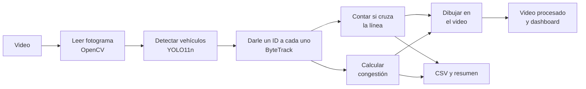
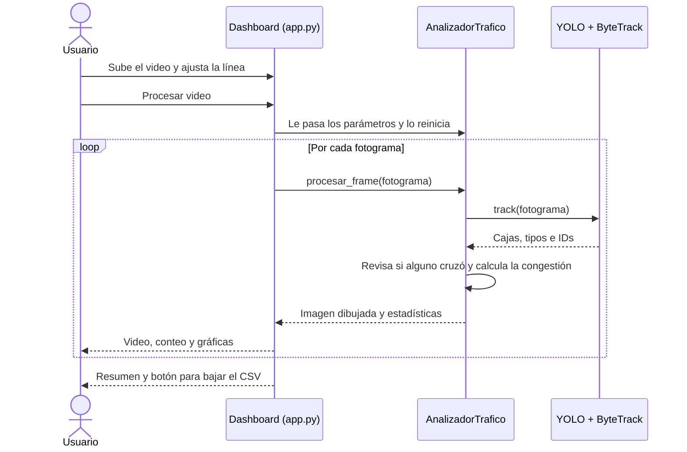

# Analizador de tráfico con YOLO

Autores: Jose Manuel Barrientos, Leidy Roldan, Juan Diego Cortes
Curso: Introducción a la Inteligencia Artificial
Fecha: noviembre de 2026

Programa que toma un video de una calle, detecta los vehículos, cuenta los que pasan por una línea (subiendo o
bajando) y dice qué tan congestionada está la vía. Tiene un dashboard web donde se ve todo mientras se procesa.

## 1. Introducción

Para saber cuántos carros pasan por una calle normalmente alguien se para con una planilla y los cuenta a mano. Eso
toma tiempo, no se puede hacer todo el día y la persona se cansa y se equivoca. Mientras tanto hay muchas cámaras
grabando las vías, pero ese video casi nunca se usa para sacar datos.

La idea del proyecto fue usar visión por computador para que el conteo lo haga el programa a partir del video. Usamos
un modelo ya entrenado (YOLO), así que no hubo que entrenar nada y todo corre en un computador normal, sin tarjeta
gráfica.

## 2. Objetivo

Objetivo general: hacer un programa que cuente y clasifique los vehículos de un video de tráfico y estime la
congestión de la vía.

Objetivos específicos:
1. Contar los vehículos que cruzan la línea con al menos un 90 % de acierto comparado con el conteo a mano.
2. Clasificar cada vehículo (auto, moto, bus o camión) y saber si iba subiendo o bajando.
3. Mostrar en un dashboard, mientras se procesa el video, el conteo y el nivel de congestión (bajo, medio o alto).

## 3. Datos

Como no entrenamos ningún modelo, los datos son los videos con los que probamos el programa.

Fuente: Videos de repositorio de github(Interseccion semaforo https://github.com/eyildiz-ugoe/smart-traffic).(Autopista con Camiones https://github.com/AyushGamer55/smart-traffic-analytics).(Autopista en doble sentido https://github.com/FarzadNekouee/YOLOv8_Traffic_Density_Estimation)

licencia: son videos publicos de esos repos , y solo se uso para fines academicos

| Video | Qué se ve | Resolución | FPS | Duración |
|---|---|---|---|---|
| 1_interseccion_semaforo_1.mp4 | Intersección con semáforo | 800x600 | 30 | 60 s |
| 2_autopista_con_camiones.mp4 | Autopista con bastante tráfico pesado | 1280x720 | 25 | 42 s |
| 3_autopista_doble_sentido_1.mp4 | Autopista de doble sentido | 1280x720 | 30 | 20 s |

Todos son de día y con la cámara quieta. YOLO viene entrenado con el dataset COCO, que tiene 80 clases; de esas solo
usamos 4: auto (clase 2), moto (3), bus (5) y camión (7). No hicimos ningún preprocesamiento, YOLO ajusta el tamaño
de cada imagen por dentro.

Para saber si el programa contaba bien, contamos a mano los carros que cruzaban la línea en cada video.

Limitaciones de los datos: son pocos videos y cortos, todos de día y con buen clima. Además COCO casi no tiene
imágenes de motos, busetas o taxis como los de acá, así que en nuestras calles podría fallar más.

## 4. Metodología


Figura 1. Lo que hace el programa con cada fotograma del video.

Pasos:
1. Se lee el video fotograma por fotograma con OpenCV.
2. YOLO detecta los vehículos y da para cada uno una caja, su tipo y qué tan seguro está (confianza).
3. ByteTrack compara las cajas con las del fotograma anterior y le mantiene el mismo número (ID) a cada vehículo.
   Sin esto, el mismo carro se contaría en todos los fotogramas.
4. Un vehículo se cuenta cuando el centro de su caja pasa de un lado de la línea al otro. Cada ID se cuenta una sola
   vez.
5. Se calcula la congestión con una fórmula que combina cuántos vehículos hay y qué tan lento van.
6. Se compara lo que contó el programa con lo que contamos nosotros a mano.

Por qué tomamos estas decisiones:

- YOLO11n: es la versión más pequeña de YOLO. No tenemos GPU y con las versiones grandes iba demasiado lento.
  Como COCO ya trae carros, motos, buses y camiones, no hizo falta entrenarlo.
- Confianza mínima de 0.35: si la subíamos se perdían carros lejanos o tapados, y si la bajábamos aparecían cajas
  donde no había nada.
- ByteTrack: viene incluido con YOLO en la librería Ultralytics. No usa otra red neuronal, solo la posición y el
  movimiento de las cajas, entonces es rápido. Si un carro queda tapado lo recuerda hasta 30 fotogramas.
- Contar cruces y no IDs: si contáramos cada ID que aparece, se sumarían los carros parqueados y los que nunca pasan
  por la vía. Y contar cada ID una sola vez evita que un carro parado encima de la línea se cuente varias veces.
- Filtro vertical: solo se cuenta el carro si en el último medio segundo (15 fotogramas) se movió más hacia arriba o
  abajo que hacia los lados. En código: abs(dy) > 0.3 * abs(dx). Lo agregamos porque en la intersección se estaban
  contando carros de la calle de lado.
- Posición de la línea: por defecto está al 60 % de la altura del video. En la intersección la subimos al 50 %
  porque los carros que giraban no alcanzaban a llegar a la línea.
- Congestión: indice = 0.6 * densidad + 0.4 * lentitud. La densidad es vehículos en pantalla / capacidad (usamos
  25) y la lentitud es 1 - velocidad promedio / velocidad normal. Le dimos más peso a la densidad porque es más
  confiable. Si el índice es menor a 0.35 es bajo, entre 0.35 y 0.65 medio, y desde 0.65 alto. Se promedia en los
  últimos 2 segundos para que no esté saltando.

Cómo medimos:
- Acierto = 1 - (contados - contados a mano) / contados a mano
- Velocidad: cuántos fotogramas por segundo procesa en CPU.

Para comparar usamos dos alternativas más simples:
- Contar todos los IDs que aparecen en el video, sin usar la línea.
- La línea como estaba al principio (al 60 % y sin el filtro vertical).

## 5. Diagrama de secuencia

Así funciona cuando alguien usa el dashboard: sube un video, ajusta la línea y le da a procesar. El dashboard le pasa
cada fotograma al analizador y va mostrando lo que devuelve.


Figura 2. Uso del dashboard.

## 6. Resultados

| Video | Contados | Autos | Camiones | Bajando / Subiendo | A mano | Acierto | FPS |
|---|---|---|---|---|---|---|---|
| 1. Intersección | 9 | 9 | 0 | 3 / 6 | 10 | 90 % | 18.0 |
| 2. Autopista con camiones | 67 | 59 | 8 | 32 / 35 | 69 | 97 %| 8.5 |
| 3. Autopista doble sentido | 29 | 25 | 4 | 16 / 13 | 29 | 100 % | 8.7 |

En ningún video se contaron motos ni buses.


Qué funcionó: contar IDs da entre 3 y 6 veces más que el resultado final, porque mete carros parqueados, los que no
pasan por la vía y los que cambian de ID cuando otro los tapa. Con la línea eso se arregla.

Lo que más nos costó fue la intersección. La primera vez el programa contó 5 y nosotros contamos 10. Revisando el
video procesado vimos que los carros que giraban se devolvían antes de llegar a la línea y que algunos que iban de
lado la cruzaban por la perspectiva. Con el filtro vertical y la línea más arriba quedó en 9 de 10. El que falta es
un carro negro que ya había cruzado en los primeros segundos, antes de que el programa pudiera verlo.

Qué no funcionó:
- El tipo de vehículo a veces cambia entre fotogramas (un camión sale como bus por un momento).
- Hubo detecciones erroneas, por ejemplo una persona en silla de ruedas detectada como moto.
- Probamos con un video grabado justo desde arriba y YOLO no reconoció los carros, los confundía con botes o trenes.
  Creemos que es porque en COCO los carros casi siempre salen de lado. Grabando en diagonal sí funcionó.

Limitaciones: la velocidad se mide en píxeles, entonces depende de qué tan lejos esté la cámara. La línea y la
capacidad hay que ajustarlas a mano para cada video. En CPU procesa entre 8.5 y 18 fotogramas por segundo, o sea que
en los videos de 720p va más lento que el video real. Tampoco lo probamos de noche ni con lluvia.

## 7. Cómo correrlo

Se necesita Python 3.9 a 3.12, no hace falta GPU.

```bash
python -m venv venv
venv\Scripts\activate
pip install -r requirements.txt
```

En Mac o Linux se activa con `source venv/bin/activate`. La primera vez que se corre se descarga solo el modelo
yolo11n.pt (unos 5 MB).

Dashboard (se abre en el navegador en http://localhost:8501):

```bash
streamlit run app.py
```

Por terminal (guarda en la carpeta resultados el video procesado, un CSV por segundo y un resumen JSON):

```bash
python main.py --video videos/2_autopista_con_camiones.mp4
python main.py --video videos/1_interseccion_semaforo_1.mp4 --linea 0.5
```

Otras opciones de main.py: `--linea` (altura de la línea, de 0 a 1), `--conf` (confianza mínima), `--capacidad`,
`--modelo` y `--mostrar` (para ver el video mientras se procesa).

Archivos:

```
analizador_trafico/
├── analizador.py    # detección, seguimiento, conteo, congestión y dibujo
├── main.py          # para correrlo desde la terminal
├── app.py           # dashboard con Streamlit
├── requirements.txt
├── videos/
└── resultados/
```
